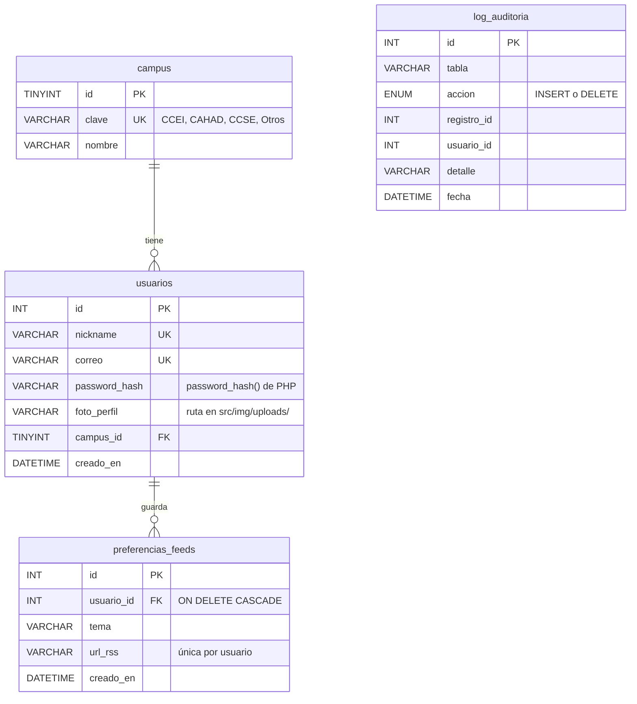

# Base de datos de TuFeedUADY

Script de creación: [`schema.sql`](schema.sql) (MySQL 8.0 o superior).

```bash
mysql -u root -p < docs/database/schema.sql
```

> El script borra y vuelve a crear la base `tufeeduady`. Úsalo solo en desarrollo.

## Diagrama entidad-relación



`log_auditoria` no tiene llaves foráneas a propósito, así el registro se conserva aunque el usuario se elimine.

## Objetos avanzados

| Tipo | Nombre | Qué hace |
|------|--------|----------|
| Vista | `vista_usuarios_campus` | Muestra cada usuario con la clave y el nombre de su campus y su número de feeds. No incluye `password_hash`. |
| Procedimiento | `sp_registrar_usuario(nickname, correo, password_hash, campus_clave, OUT usuario_id)` | Valida que el campus exista (lanza `SQLSTATE 45000` si no) e inserta el usuario. |
| Procedimiento | `sp_buscar_feeds(usuario_id, palabra)` | Busca los feeds del usuario cuyo tema o URL contengan la palabra. Con la palabra vacía devuelve todos. |
| Disparador | `tr_auditoria_usuarios_insert` / `_delete` | Registra en `log_auditoria` cada alta y baja de usuario. |
| Disparador | `tr_auditoria_preferencias_insert` / `_delete` | Registra en `log_auditoria` cada alta y baja de feed. |

MySQL no ejecuta disparadores en los borrados por `ON DELETE CASCADE`. Cuando se elimina un usuario solo queda registrada la baja del usuario, no la de cada uno de sus feeds.

## Endpoints PHP (`src/includes/`)

Todas las respuestas son JSON con la forma `{"ok": true, "mensaje": "...", "datos": ...}` o `{"ok": false, "error": "..."}`. Los datos de entrada se pueden mandar como JSON (`Content-Type: application/json`) o como formulario.

| Archivo | Método y parámetros | Descripción |
|---------|---------------------|-------------|
| `auth.php?accion=registro` | `POST` nickname, correo, password, campus | Crea la cuenta e inicia sesión. |
| `auth.php?accion=login` | `POST` usuario (nickname o correo), password | Inicia sesión. |
| `auth.php?accion=logout` | `POST` | Cierra la sesión. |
| `auth.php?accion=sesion` | `GET` | Devuelve el usuario con sesión activa. |
| `crud_preferencias.php` | `GET` `?q=palabra` opcional, `?id=` opcional | Consulta y busca los feeds del usuario. |
| `crud_preferencias.php` | `POST` tema, url_rss | Alta de un feed. |
| `crud_preferencias.php` | `PUT` id, tema, url_rss | Cambio de un feed. |
| `crud_preferencias.php` | `DELETE` id | Baja de un feed. |
| `upload_avatar.php` | `POST` (multipart) campo `avatar` | Sube la foto de perfil (JPG, PNG o WebP, máx. 2 MB). |
| `upload_avatar.php?accion=descargar_avatar` | `GET` | Descarga la foto de perfil. |
| `upload_avatar.php?accion=exportar_feeds` | `GET` | Descarga los feeds del usuario en un archivo `.json`. |

Todos los endpoints salvo registro y login piden una sesión activa.

## Configuración de la conexión

`conexion.php` lee estas variables de entorno y, si no existen, usa los valores por defecto de XAMPP:

| Variable | Valor por defecto |
|----------|-------------------|
| `DB_HOST` | `127.0.0.1` |
| `DB_PORT` | `3306` |
| `DB_NAME` | `tufeeduady` |
| `DB_USER` | `root` |
| `DB_PASS` | *(vacía)* |
